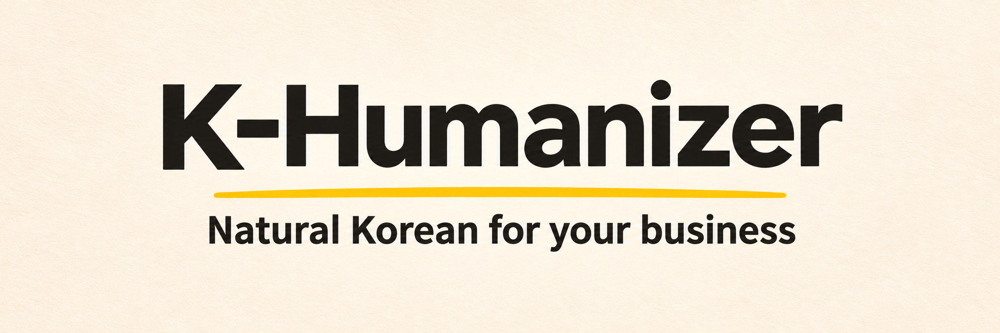

# K-Humanizer



[한국어](README.md)

[](CHANGELOG.md)

K-Humanizer is a set of instructions that translates and polishes messages for Korean customers into natural Korean. It focuses on the translationese and awkward phrasing that overseas teams who are not native Korean speakers run into when writing sales emails, ads, product descriptions, customer support, app notices, and similar content.

Besides foreign-language text, you can also use it to smooth the wording of resumes, documents, emails, and other material you wrote directly in Korean.

---

## Example

| Item | Content |
| :--- | :--- |
| **What you want to say** | Could you send us your available times for next week? |
| **Typical AI translation** | 다음 주 귀하의 이용 가능한 시간을 저희에게 보내주실 수 있으신가요? |
| **Polished sentence** | 다음 주 가능한 시간을 알려주실 수 있을까요? |

> This example is meant to aid understanding; actual model output may vary by environment.

---

## How to use it

Give the LLM the instructions in [SKILL.md](skills/k-humanizer/SKILL.md) and the [use cases](skills/k-humanizer/references/use-cases.md) you need, then make a request like one of these.

- You have only a Korean draft: it smooths awkward wording and translationese into natural Korean.
- You have both the foreign-language text and a Korean draft: it compares the two and fixes anything missing or distorted, along with awkward wording.
- You have only the foreign-language text: it translates it into Korean suited to the reader and channel.

The checks used English source text; other source languages have not been evaluated. The instructions say to preserve conditions such as prices, dates, and policies, and not add claims the source does not contain.

> Tell it who will read the text, which channel it is for, and the tone you want, and you will get more fitting wording. If you want explanations in English, say so in your request.

---

## Where to use it

We recommend entering the instructions directly into an LLM API or a web chat interface. In agent environments, the instructions may conflict with internal system prompts and not work as intended. (Even in an API or on the web, results can vary with the model and settings you use.)

In an API or on the web, a link alone may not let the model read the files, so paste the text of [SKILL.md](skills/k-humanizer/SKILL.md) and the reference files you need (such as the [use cases](skills/k-humanizer/references/use-cases.md)) directly.

You can also install it as a skill in Codex, Claude, Cursor, and similar tools.

```bash
npx skills add evergreentree97/K-Humanizer --skill k-humanizer --full-depth
```

---

## Version history

| Version | Date | Highlights |
| :--- | :--- | :--- |
| **0.5.0** | 2026-11-07 | Business Korean for Korean customers: translate and check sales emails, ads, product pages, support replies, and app strings against the English source |
| 0.4.0 | 2026-11-06 | Edits by context and meaning instead of character-change limits |
| 0.3.1 | 2026-09-14 | Keeps connectors and sentence flow |
| 0.3.0 | 2026-08-25 | Application-motivation and public-post guidance, and a 220-case model baseline |
| 0.2.0 | 2026-08-17 | Resume guidance and public validation tools |
| 0.1.0 | 2026-07-04 | First public release |

Planned next: answer notes and questions in English when the request is in English, and add a back-translation and a short register note so people who do not read Korean can check the result. See the [CHANGELOG](CHANGELOG.md) for every change.

## Evaluation

The record of the business Korean checks is in the [business Korean check report](evals/reports/2026-11-07-business-korean/business-review.md). They are development-stage checks in which one model handled model-written synthetic cases and another model scored them. They are not a native Korean reader's review or a customer study, so they do not validate quality.

## License

[MIT](LICENSE)
