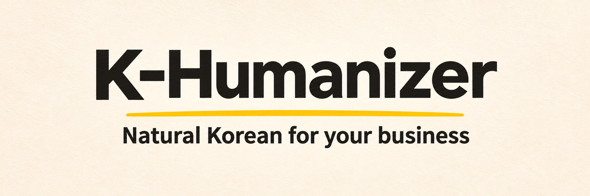

# K-Humanizer



[English](README.en.md)

[](CHANGELOG.md)

K-Humanizer는 한국 고객에게 보낼 메시지를 자연스러운 한국어로 번역하고 다듬어주는 지침입니다. 한국어가 모국어가 아닌 해외 팀이 영업 메일, 광고, 제품 소개, 고객 지원, 앱 안내 등을 작성할 때 겪는 번역투와 어색한 표현을 해결하는 데 초점을 맞췄습니다.

외국어 텍스트뿐만 아니라, 한국어로 직접 작성한 문서, 메일 등의 표현을 매끄럽게 다듬는 용도로도 사용할 수 있습니다. 이력서와 지원서는 별도 스킬인 [K-Humanizer Resume](skills/k-humanizer-resume/SKILL.md)에서 다룹니다.

---

## 사용 예시

| 구분 | 내용 |
| :--- | :--- |
| **작성할 내용** | Could you send us your available times for next week? |
| **일반적인 AI 번역** | 다음 주 귀하의 이용 가능한 시간을 저희에게 보내주실 수 있으신가요? |
| **다듬은 문장** | 다음 주 가능한 시간을 알려주실 수 있을까요? |

> 위 예시는 이해를 돕기 위한 것이며, 실제 모델 출력은 환경에 따라 다를 수 있습니다.

---

## 사용 방법

[SKILL.md](skills/k-humanizer/SKILL.md)의 지침과 필요한 [비즈니스 한국어](skills/k-humanizer/references/business-korean.md)와 [한국어 글쓰기 사례](skills/k-humanizer/references/native-writing.md)를 LLM에 전달한 뒤, 다음과 같이 요청해 보세요.

- 한국어 초안만 있을 때: 어색한 표현과 번역투를 자연스럽게 다듬습니다.
- 외국어와 한국어 초안이 함께 있을 때: 두 내용을 비교해 누락되거나 왜곡된 부분, 어색한 표현을 바로잡습니다.
- 외국어만 있을 때: 독자와 채널 특성에 맞는 한국어로 번역합니다.

영어로 점검했으며, 다른 외국어 입력은 아직 평가하지 않았습니다.
> 읽는 사람, 사용할 채널, 원하는 말투를 함께 알려 주시면 훨씬 더 알맞은 문구를 얻을 수 있습니다. 설명을 영어로 받고 싶다면 요청 시 함께 적어주세요.

---

## 사용 환경

Claude Code와 Codex에서는 플러그인으로 두 스킬을 함께 설치할 수 있습니다.

Claude Code:

```bash
claude plugin marketplace add evergreentree97/K-Humanizer
claude plugin install k-humanizer@k-humanizer
```

Codex:

```bash
codex plugin marketplace add evergreentree97/K-Humanizer
codex plugin add k-humanizer@k-humanizer
```

Cursor 같은 다른 에이전트에서는 스킬을 개별 설치하세요.

```bash
npx skills add evergreentree97/K-Humanizer --skill k-humanizer --full-depth
```

이력서와 지원서를 다듬으려면 이력서 스킬도 설치하세요.

```bash
npx skills add evergreentree97/K-Humanizer --skill k-humanizer-resume --full-depth
```

웹 채팅이나 API에서 쓸 때는 링크만 알려 주면 모델이 파일을 읽지 못할 수 있으므로, [SKILL.md](skills/k-humanizer/SKILL.md)와 필요한 참고 파일([비즈니스 한국어](skills/k-humanizer/references/business-korean.md)와 [한국어 글쓰기 사례](skills/k-humanizer/references/native-writing.md) 등)의 텍스트를 직접 붙여 넣어 주세요. 결과는 사용하는 모델과 설정에 따라 다를 수 있습니다.

---

## 버전 기록

| 버전 | 날짜 | 주요 변경 |
| :--- | :--- | :--- |
| **0.6.0** | 2026-11-10 | Claude Code와 Codex에 플러그인으로 설치합니다. 이력서와 지원서는 별도 스킬 `k-humanizer-resume`으로 나눴습니다 |
| 0.5.0 | 2026-11-07 | 한국 고객용 비즈니스 한국어 지원. 영업 메일, 광고, 제품 페이지, 고객 지원, 앱 문구를 번역하고 영어 원문과 대조합니다 |
| 0.4.0 | 2026-11-06 | 글자 수 기준 대신 문맥과 의미 보존을 기준으로 편집합니다 |
| 0.3.1 | 2026-09-14 | 연결어와 문장 흐름을 살리도록 고쳤습니다 |
| 0.3.0 | 2026-08-25 | 지원 동기와 공개 게시글 지침, 220건 모델 기준선을 추가했습니다 |
| 0.2.0 | 2026-08-17 | 이력서 지침과 공개 검증 도구를 추가했습니다 |
| 0.1.0 | 2026-07-04 | 첫 공개 |

영어로 요청하면 설명과 질문도 영어로 답하라는 지시는 이미 들어 있지만, 기본 상태로 점검한 3건은 모두 한국어로 답했습니다. 지금은 설명을 영어로 받고 싶다고 요청에 함께 적어 주세요. 다음 버전에서는 이 부분을 고치고, 한국어를 읽지 못하는 사용자가 결과를 확인할 수 있게 역번역과 말투 설명을 붙일 계획입니다. 전체 변경 내역은 [CHANGELOG](CHANGELOG.md)에 있습니다.

## 평가

비즈니스 한국어 점검 기록은 [비즈니스 한국어 점검 보고서](evals/reports/2026-11-07-business-korean/business-review.md)에 있습니다. 

## 라이선스

[MIT](LICENSE)
